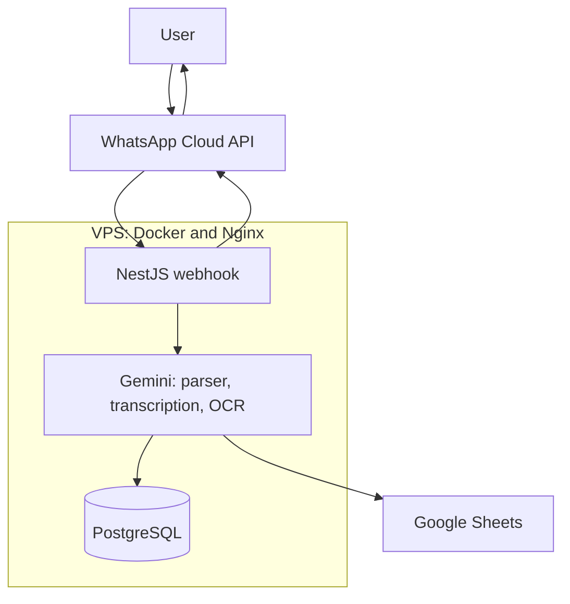

<p align="center"></p>

<h1 align="center">Accountant on WhatsApp</h1>

<h3 align="center">A bot that books expenses and income straight from the chat. You type, talk, or send a receipt photo; the rest happens by itself.</h3>

<p align="center">
  
  
  
  
  
  
  
</p>

---

## Table of Contents

- [About](#about)
- [Screenshots](#screenshots)
- [Source Code](#source-code)
- [Tech Stack](#tech-stack)
- [Features](#features)
- [Architecture](#architecture)
- [Statistics](#statistics)
- [Contact](#contact)

---

## About

Tracking personal expenses is not simple: it means manually opening the right place and clicking through a form. That friction is enough for a receipt to disappear in a pocket, a small purchase to slip away, and after a month nobody knows where the money went. WhatsApp is always at hand, so it became the form.

The bot accepts three inputs: text ("Coffee 15 PLN"), a voice message, or a receipt photo. It recognizes amounts and categories per line item, not one category per receipt. The record goes to a database and to a copy in Google Sheets. A mistake gets undone with the `/undo` command. A shared bill is handled by a note on the photo: "I pay 50%" rescales the items before saving.

In production since December 2025, used daily by the author. Real life drove each new feature: bill splitting after a shared purchase, gift cards before the holidays, undo after a misread.

---

## Screenshots

| Text: "Coffee 15 PLN" and done | Voice message broken into line items |
|:---:|:---:|
|  |  |

| Receipt from a photo, category per item | /undo reverts the last entry |
|:---:|:---:|
|  |  |

> **Note:** the screenshots are chat mockups with fictional amounts, store, and identifiers. The message layout matches 1:1 what the bot sends in production. No real expenses are published.

---

## Source Code

The code is private. This repository documents the project: description, architecture, and screenshots.

---

## Tech Stack

### Bot and API

```
NestJS 11 + TypeScript     // webhook, parser, CRUD: 4 modules, 11 endpoints
WhatsApp Cloud API         // text, OGG/Opus audio, photos, markAsRead
Gemini 2.5 Flash           // JSON parser, PL transcription, two-stage vision OCR
```

### Data

```
PostgreSQL 16 + TypeORM    // transactions and items, cascading delete
Google Sheets API          // copy: Transactions and Items tabs
```

### Operations

```
Docker Compose on a VPS    // app + postgres, node:20-alpine image
Nginx + Let's Encrypt      // TLS, proxy to the container
```

---

## Features

### Expense Capture

- **Three ways to record** - text, voice message, or a receipt photo. Recording takes seconds, so even a small purchase does not slip away
- **Per-item categories** - a receipt with a toy and milk does not land in one category. Each item gets its own, and a mixed transaction is marked as mixed
- **Polish voice messages** - the recording becomes text, and the text becomes line items with amounts and categories. The full transcription stays on the transaction's note
- **Two-step receipt OCR** - first the text from the photo, then the line items with amounts. A caption under the photo can change an item's category

### Everyday Life

- **Bill splitting** - a note like "I pay half" or "50% back from Ania" on the photo rescales the amounts and adds a note. Shared purchases stop corrupting the statistics
- **Gift cards** - a received card is income, one bought for someone is an expense, a coupon on the receipt is a negative-priced item
- **/undo** - reverts the last entry from the database and the sheet. A misread does not stay in the data
- **Income** - salary, refunds, and gifts go into the same system, with their own categories

### Data and Integrations

- **Google Sheets copy** - every record also lands in the sheet: transactions and items in separate tabs. The sheet stays the source for custom analysis
- **Duplicate resistance** - the same message from Meta never gets recorded twice
- **Decimal quantities** - 0.765 kg of cheese is a valid line item, not a rounding error

---

## Architecture



---

## Statistics

### Technical Complexity

| Metric | Count |
|---|---|
| **Commits** | 9 (December 2025 - March 2026) |
| **Authors** | 1 |
| **Lines of TypeScript** | 2,405 |
| **NestJS modules** | 4 |
| **HTTP endpoints** | 11 |
| **Entities** | 2 (transaction, item) |
| **Categories** | 11 expense + 5 income |
| **Currencies** | PLN, EUR, USD, GBP |

### Features Overview

| Category | Highlights |
|---|---|
| **Capture** | text, voice, receipt, per-item categories |
| **Life** | bill splitting, gift cards, /undo |
| **Data** | PostgreSQL, Sheets copy, webhook dedup |

---

## Contact

| Platform | Link |
|---|---|
| **WWW** | [kamilkaczmareksolutions.com](https://kamilkaczmareksolutions.com) |
| **GitHub** | [kamilkaczmareksolutions](https://github.com/kamilkaczmareksolutions) |
| **LinkedIn** | [Kamil Kaczmarek](https://www.linkedin.com/in/kamilkaczmareksolutions) |
| **Email** | [recruitment@kamilkaczmareksolutions.com](mailto:recruitment@kamilkaczmareksolutions.com) |

---

**Accountant on WhatsApp** - expenses recorded at the moment of purchase, not a month later.

<p align="center"><em>Built by Kamil Kaczmarek</em></p>
