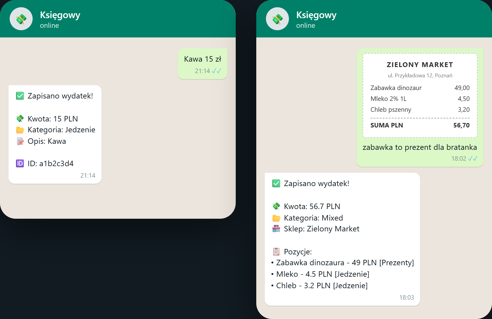
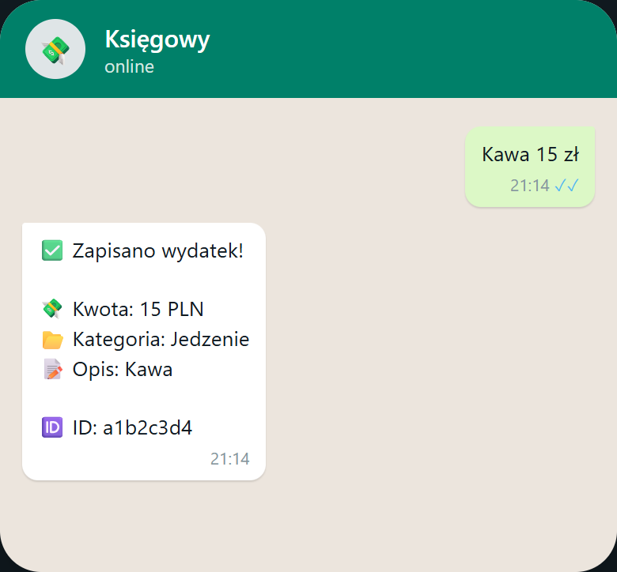
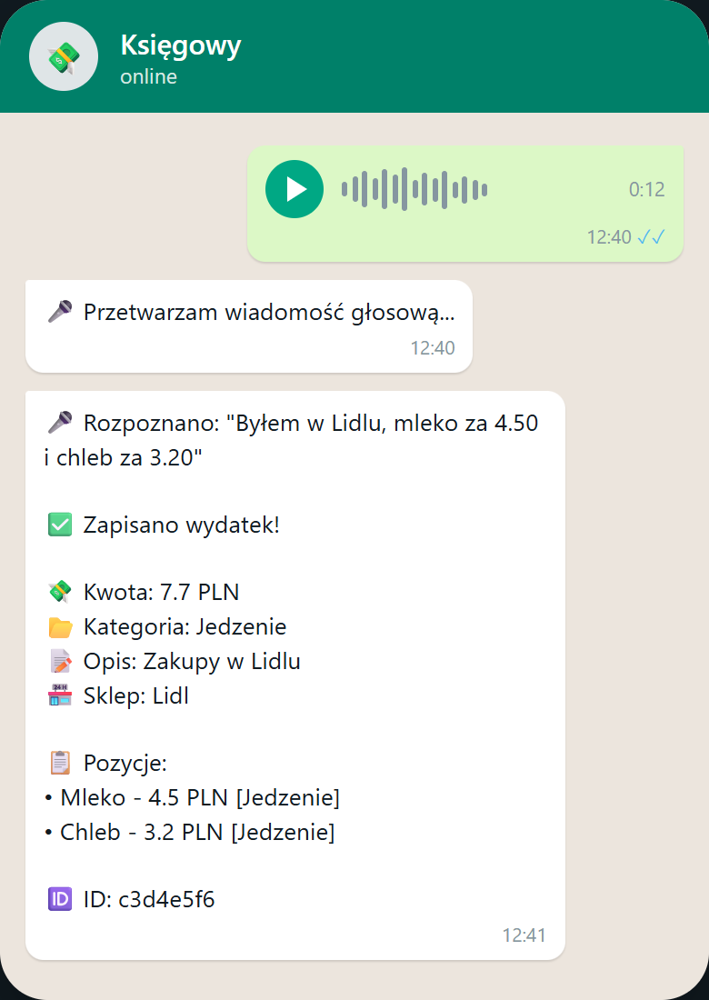
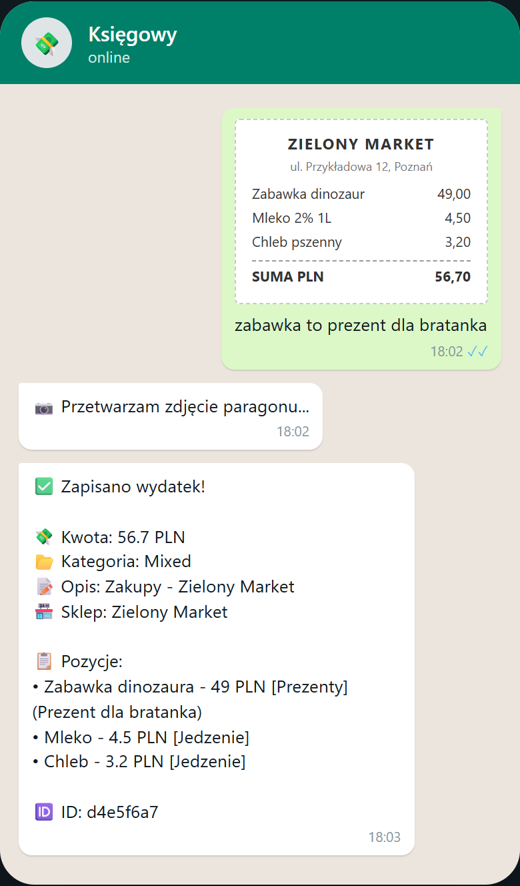
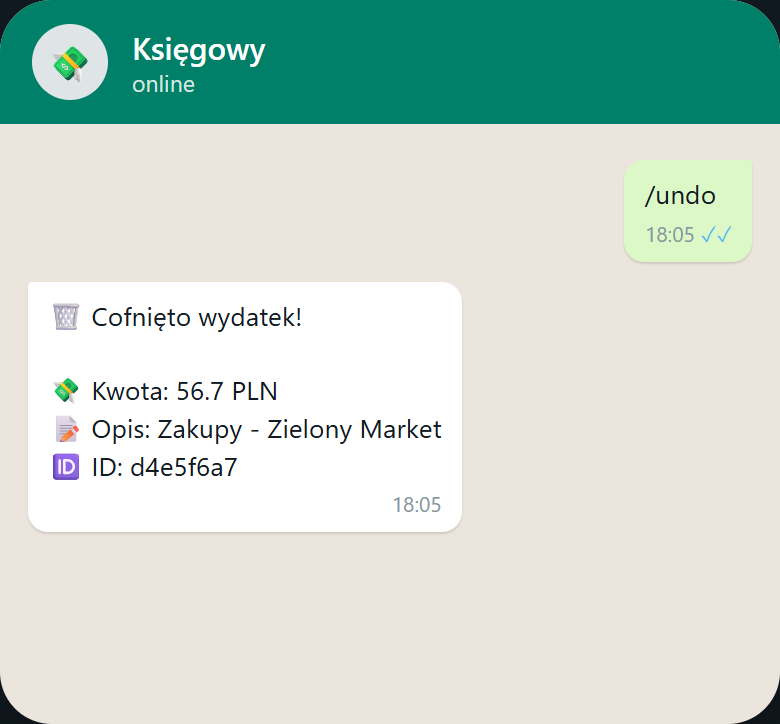
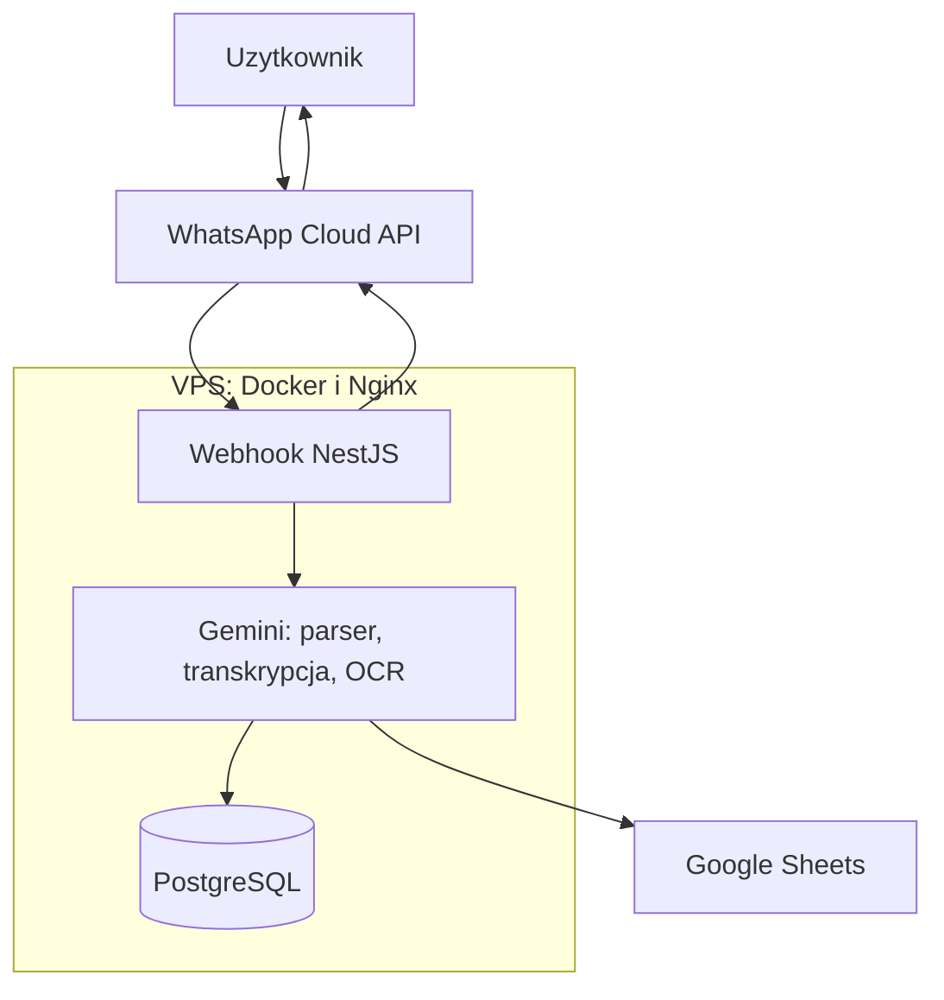

<p align="center"><b>Polski</b> | <a href="README.en.md">English</a></p>

<p align="center"></p>

<h1 align="center">Księgowy w WhatsApp</h1>

<h3 align="center">Bot, który księguje wydatki i wpływy prosto z czatu. Piszesz, mówisz albo wysyłasz zdjęcie paragonu, reszta dzieje się sama.</h3>

<p align="center">
  
  
  
  
  
  
  
</p>

---

## Spis treści

- [O projekcie](#o-projekcie)
- [Screenshoty](#screenshoty)
- [Kod źródłowy](#kod-źródłowy)
- [Stack](#stack)
- [Funkcje](#funkcje)
- [Architektura](#architektura)
- [Statystyki](#statystyki)
- [Kontakt](#kontakt)

---

## O projekcie

Zapisywanie wydatków osobistych nie jest proste: wymaga ręcznego wejścia w odpowiednie miejsce i przeklikania formularza. To tarcie sprawia, że paragon ginie w kieszeni, drobny wydatek umyka, a po miesiącu nikt nie wie, gdzie poszły pieniądze. WhatsApp jest zawsze pod ręką, więc to on stał się formularzem.

Bot przyjmuje trzy drogi: tekst ("Kawa 15 zł"), głosówkę albo zdjęcie paragonu. Rozpoznaje kwoty i kategorie per pozycja, nie jedną kategorię na cały paragon. Zapis idzie do bazy i do kopii w arkuszu Google. Pomyłkę cofa komenda `/undo`. Rachunek współdzielony załatwia dopisek przy zdjęciu: "płacę 50%" przelicza pozycje przed zapisem.

Produkcja od grudnia 2025, używany codziennie przez autora. Kolejne funkcje dodawało życie: dzielenie rachunków po wspólnym zakupie, karty podarunkowe przed świętami, cofanie po błędnym odczycie.

---

## Screenshoty

| Tekst: "Kawa 15 zł" i gotowe | Głosówka rozpisana na pozycje |
|:---:|:---:|
|  |  |

| Paragon ze zdjęcia, kategoria per pozycja | /undo cofa ostatni zapis |
|:---:|:---:|
|  |  |

> **Nota:** kadry to makiety czatu z fikcyjnymi kwotami, sklepem i identyfikatorami. Układ wiadomości odpowiada 1:1 temu, co bot wysyła na produkcji. Żadne prawdziwe wydatki nie są publikowane.

---

## Kod źródłowy

Kod jest prywatny. To repo dokumentuje projekt: opis, architekturę i zrzuty działania.

---

## Stack

### Bot i API

```
NestJS 11 + TypeScript     // webhook, parser, CRUD: 4 moduły, 11 endpointów
WhatsApp Cloud API         // tekst, audio OGG/Opus, zdjęcia, markAsRead
Gemini 2.5 Flash           // parser JSON, transkrypcja PL, OCR vision dwuetapowo
```

### Dane

```
PostgreSQL 16 + TypeORM    // transakcje i pozycje, kaskadowe usuwanie
Google Sheets API          // kopia: zakładki Transactions i Items
```

### Operacje

```
Docker Compose na VPS      // app + postgres, obraz node:20-alpine
Nginx + Let's Encrypt      // TLS, proxy na kontener
```

---

## Funkcje

### Zapis wydatków

- **Trzy drogi zapisu** - tekst, głosówka albo zdjęcie paragonu. Zapis trwa sekundy, więc nie umyka nawet drobny wydatek
- **Kategorie per pozycja** - paragon z zabawką i mlekiem nie ląduje w jednej kategorii. Każda pozycja dostaje swoją, a transakcja mieszana jest oznaczona jako mieszana
- **Głosówki po polsku** - nagranie zamieniane jest na tekst, z którego powstają pozycje z kwotami i kategoriami. Pełna transkrypcja zostaje w notatce do transakcji
- **OCR paragonu w dwóch krokach** - najpierw tekst ze zdjęcia, potem pozycje z kwotami. Dopisek pod zdjęciem potrafi zmienić kategorię pozycji

### Życie codzienne

- **Dzielenie rachunku** - dopisek "płacę połowę" albo "50% odda mi Ania" przy zdjęciu przelicza kwoty i dopisuje notę. Wspólne zakupy przestają psuć statystyki
- **Karty podarunkowe** - otrzymana karta to wpływ, kupiona dla kogoś to wydatek, kupon na paragonie to pozycja z ujemną ceną
- **/undo** - cofa ostatni zapis z bazy i z arkusza. Błędny odczyt nie zostaje w danych
- **Wpływy** - pensja, zwroty i prezenty trafiają do tego samego systemu, z osobnymi kategoriami

### Dane i integracje

- **Kopia w Google Sheets** - każdy zapis ląduje też w arkuszu: transakcje i pozycje w osobnych zakładkach. Arkusz zostaje źródłem do własnych analiz
- **Odporność na duplikaty** - ta sama wiadomość od Meta nie zapisuje się dwa razy
- **Ilości dziesiętne** - 0.765 kg sera to poprawna pozycja, nie błąd zaokrąglenia

---

## Architektura



---

## Statystyki

### Złożoność techniczna

| Metryka | Wartość |
|---|---|
| **Commity** | 9 (grudzień 2025 - marzec 2026) |
| **Autorzy** | 1 |
| **Linie TypeScript** | 2 405 |
| **Moduły NestJS** | 4 |
| **Endpointy HTTP** | 11 |
| **Encje** | 2 (transakcja, pozycja) |
| **Kategorie** | 11 wydatków + 5 wpływów |
| **Waluty** | PLN, EUR, USD, GBP |

### Przegląd funkcji

| Kategoria | Najważniejsze |
|---|---|
| **Zapis** | tekst, głosówka, paragon, kategorie per pozycja |
| **Życie** | dzielenie rachunku, karty podarunkowe, /undo |
| **Dane** | PostgreSQL, kopia w Sheets, dedup webhooka |

---

## Kontakt

| Platforma | Link |
|---|---|
| **WWW** | [kamilkaczmareksolutions.com](https://kamilkaczmareksolutions.com) |
| **GitHub** | [kamilkaczmareksolutions](https://github.com/kamilkaczmareksolutions) |
| **LinkedIn** | [Kamil Kaczmarek](https://www.linkedin.com/in/kamilkaczmareksolutions) |
| **Email** | [recruitment@kamilkaczmareksolutions.com](mailto:recruitment@kamilkaczmareksolutions.com) |

---

**Księgowy w WhatsApp** - wydatki zapisane w chwili zakupu, nie po miesiącu.

<p align="center"><em>Zbudował Kamil Kaczmarek</em></p>
